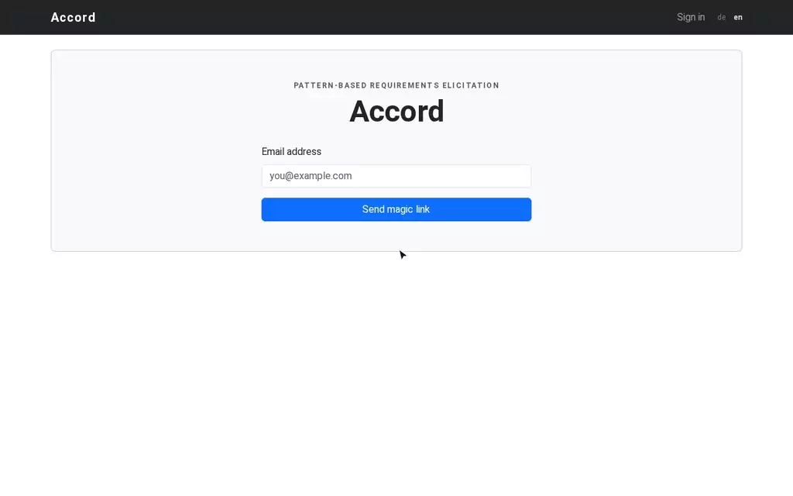
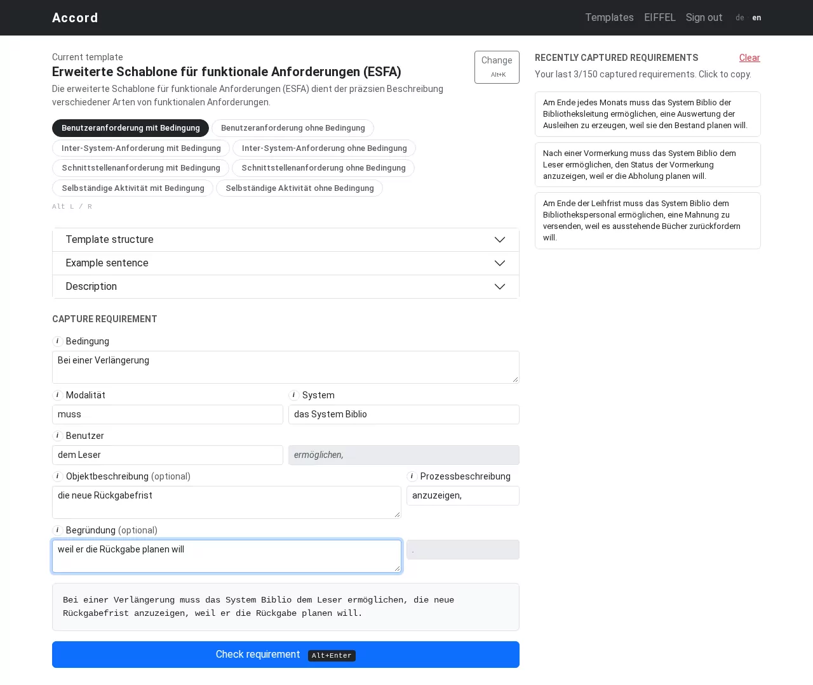
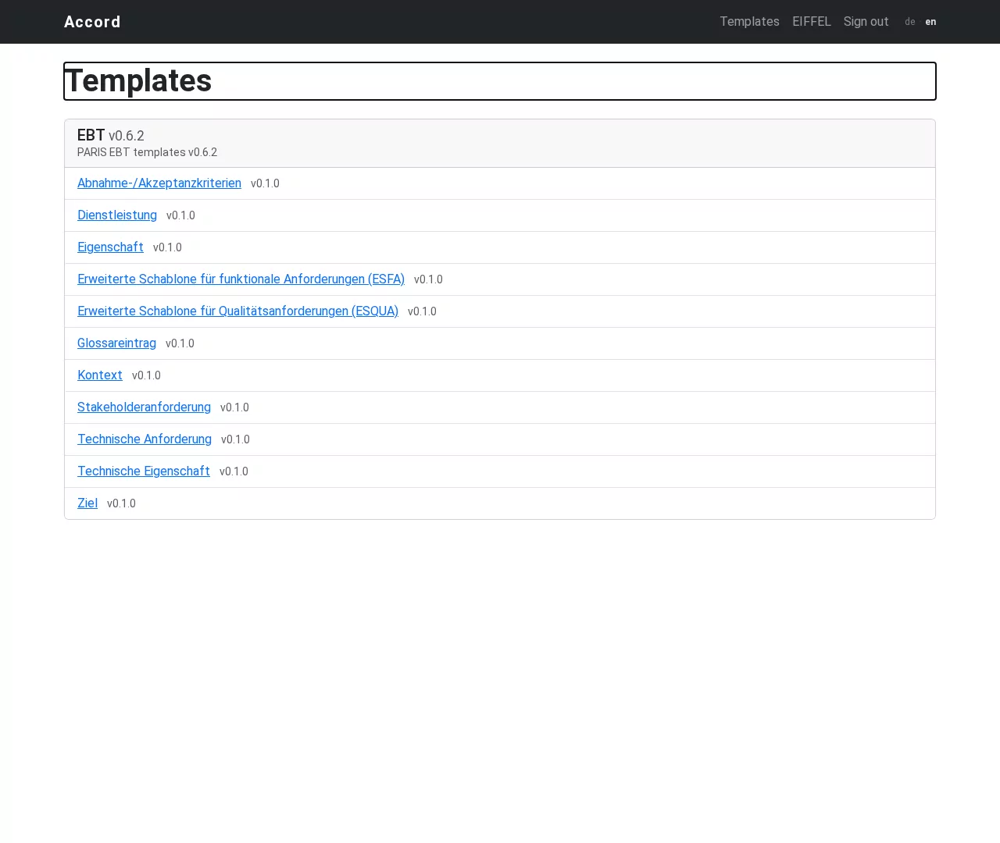
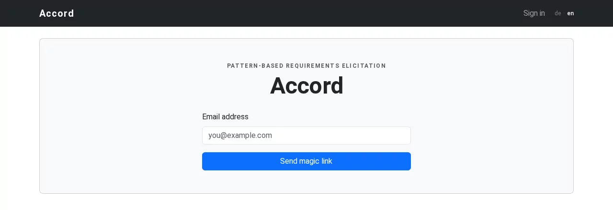
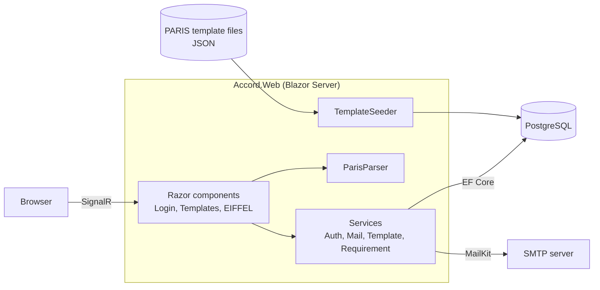

# Accord

Accord is a web application for template-based requirements elicitation. It supports Controlled Natural Languages (CNLs, or pattern languages) such as [PARIS](https://www.researchgate.net/publication/363630019_Anforderungen_strukturiert_mit_Schablonen_dokumentieren_in_PARIS).

Accord tries to rewrite [HARMONY](https://github.com/org-harmony/harmony) in C#. HARMONY is the original tool and it is in use.

> **Notice:** Accord is for educational purposes. It is not a replacement for HARMONY.



[Watch as MP4 with player controls](docs/images/accord-demo.mp4) (1 min)

## What it does

1. The user signs in with a magic link sent by email.
2. The user selects a PARIS template and a variant.
3. The elicitation interface (EIFFEL) checks each input and shows the requirement sentence during input.
4. The application saves the requirement and copies it to the clipboard.

The PARIS templates are in German, so the requirement text is in German. The home page, sign-in page, and EIFFEL support German and English. The template pages use English.

| Elicitation | Templates |
| --- | --- |
|  |  |



## Architecture



See [ARCHITECTURE.md](ARCHITECTURE.md) for details.

## Differences from HARMONY

| Area | HARMONY | Accord |
| --- | --- | --- |
| Language | Go | C# / .NET 10 |
| Frontend | HTMX and Go templates | Blazor Server |
| Sign-in | OAuth2 with external providers | Magic link by email |
| Templates | Per-user template management | Default PARIS templates for all users |

## Stack

- C# / .NET 10, Blazor Server
- Entity Framework Core, PostgreSQL (Npgsql)
- Bootstrap 5
- MailKit

## Run locally

You need the .NET 10 SDK and Docker.

```bash
Mail__Port=1025 make dev
```

This starts PostgreSQL and Maildev, then runs the application with `dotnet watch` on http://localhost:8000. The application applies migrations and loads the templates at startup.

## License

[MPL 2.0](LICENSE)
